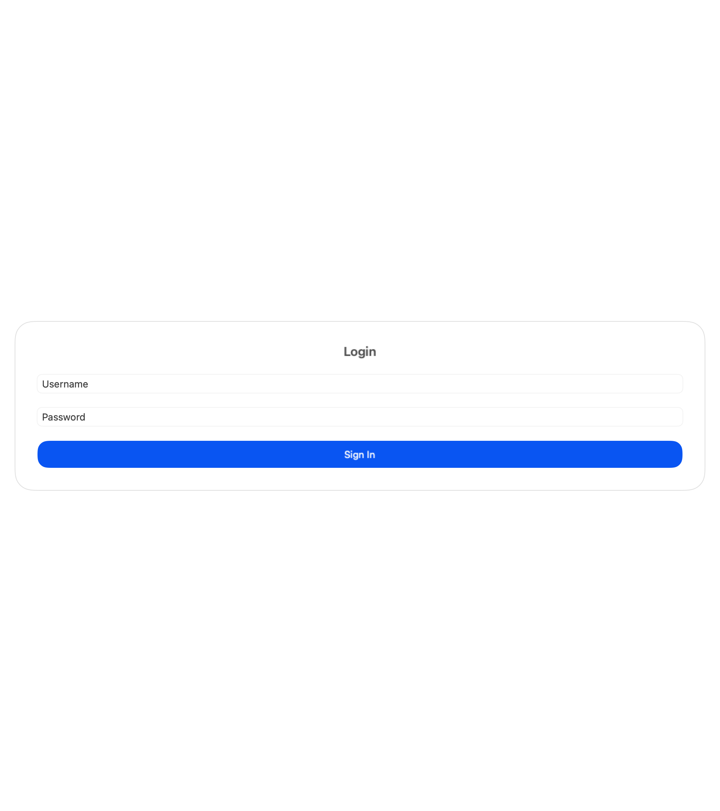
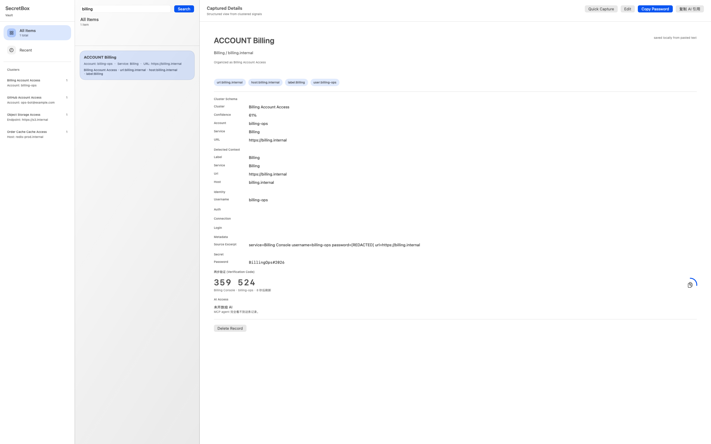
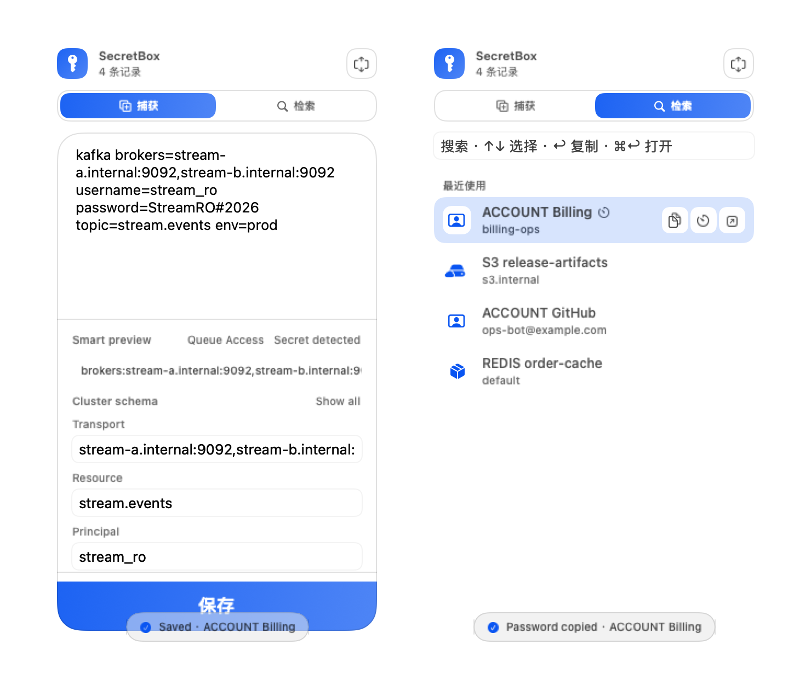
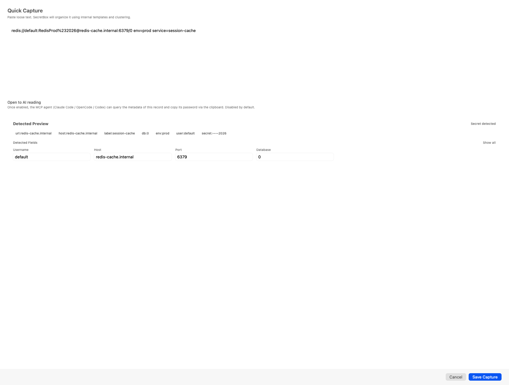
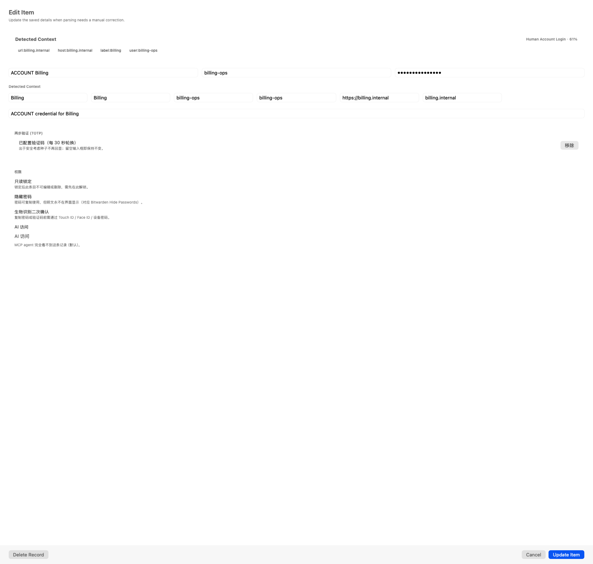
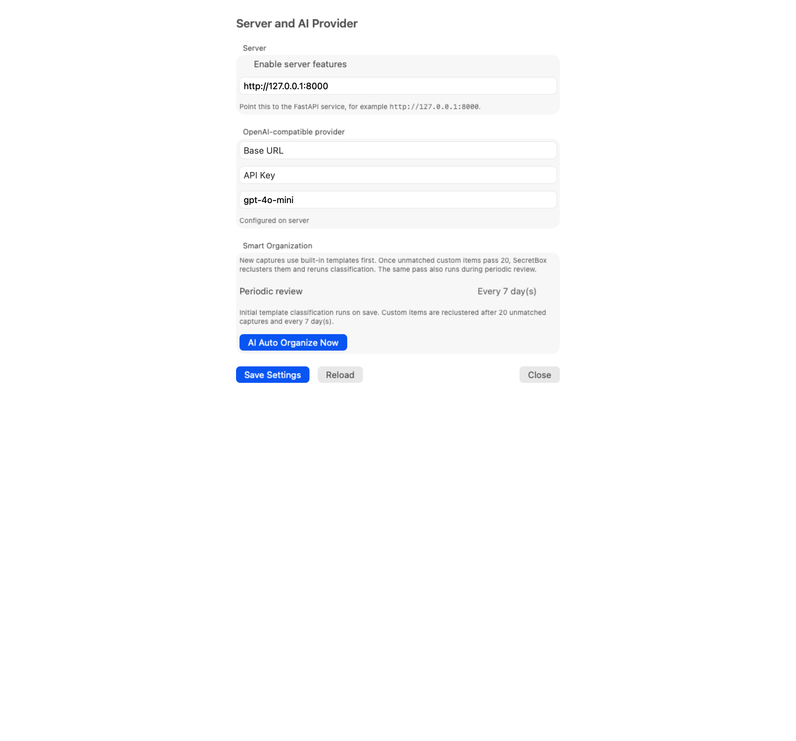

**English** · [简体中文](README.zh-CN.md)

# SecretBox

**The AI-native password manager — for teams and individuals.** Store credentials once; humans *and* AI agents use them without plaintext ever entering a conversation, a terminal, or a model's context. Think "1Password, reimagined for the age of AI agents".

## The problem we solve

AI coding agents and chat assistants constantly need credentials — database URLs, API keys, service passwords. Today that means pasting plaintext into chats, terminals, and config files, where it leaks into logs, session transcripts, and vendor pipelines. Letting an AI agent anywhere near production secrets has been a non-starter — until now.

## How SecretBox fixes it

- **Agents see metadata, not secrets.** The built-in MCP server lets Claude Code / OpenCode / Codex search your vault and read redacted details (name, type, host, the shape of the secret). Plaintext is structurally impossible in any response.
- **Secrets travel by clipboard.** When an agent genuinely needs the password or the current two-step code, `copy_password` / `copy_totp` place it on the clipboard for the human to paste — it never passes through the conversation.
- **Paste a reference, not the secret.** The "复制 AI 引用" button copies a `<secretbox-credential id=…>` snippet that is safe to paste into any chat; the agent resolves it through the MCP server in one call.
- **Every record carries an AI permission level** — denied (default) / metadata / metadata + tools. Denied records are indistinguishable from missing ones: no metadata, no existence leak.

## A complete password manager underneath

Paste a connection string or an account snippet, get an organized item — ops-native templates for redis / s3 / database / kafka / aksk, plus everyday accounts — with local-first encryption. The password-manager fundamentals are all here:

- **Seamless MFA (built-in authenticator)** — paste a base32 seed or an `otpauth://` link (or scan a QR code on iPhone) and the item grows a **live 30-second verification code**; the countdown ring doubles as the copy button, in the main window and the menu bar alike. Codes are generated entirely on-device (RFC 6238); the server only ever stores the seed as ciphertext.
- **Granular per-item permission management** — read-only lock, hidden password (usable but never visible), biometric re-prompt before any secret use, and three-level AI access. Every subject — a human *or* an AI agent — is gated per item, and denied records are indistinguishable from missing ones.
- **Team sharing on the roadmap** — Bitwarden-style collections, groups, and roles (Owner / Admin / Manager / User) with per-collection grants land in phase 2, together with server-side enforcement; the per-record permission structure already reserves the subjects for it.

Everything runs on your device: a SwiftUI client (macOS menu bar + main window / iPhone), an optional FastAPI server, and a zero-dependency MCP server.

## Screenshots & Usage

### 1. Sign in

Launch and sign in with any non-empty credentials (local demo login for now; real server auth is on the roadmap).



### 2. The vault

The main window has three panes: filters and clusters on the left, the item browser in the middle, and the full detail on the right. Type a keyword (host / service / env / username / tag) and hit **Search** — or paste the password itself for an exact keyed-hash match.



The detail pane shows the structured record: cluster schema, detected context, identity, fields, the secret, and — for items with two-step verification — the **live verification code** that rotates every 30 seconds. Click the countdown ring to copy the code; **Copy Password** sits right next to it.

### 3. Menu bar panel (macOS)

The menu bar popover packs both everyday moves into one compact panel, with a 捕获 / 检索 toggle that remembers your last mode:

- **捕获 (Capture)** — paste loose text, check the Smart Preview, hit **⌘↩** (or ⌘S) to save. 保存 stays disabled until a real secret or `otpauth://` URI is detected, so junk never lands in the vault.
- **检索 (Quick access)** — type a keyword, move with **↑↓**, press **↩** to copy the password (or the current TOTP code for authenticator-only items), **⌘↩** to reveal the record in the main window. An empty query lists your most recently used items; every copy confirms with a transient capsule.



Every quick copy respects the item's permissions — biometric re-prompt items ask first, and items denied to AI never expose the AI-reference action.

### 4. Quick capture

Click **Quick Capture** (the + button) and paste anything loose — a redis URI, an S3 key pair, an account snippet, or text with an embedded `otpauth://` link. The Smart Preview shows what SecretBox detected (type, tags, fields) and lets you correct individual fields before saving.



Pasting an `otpauth://` Key URI alongside the credentials automatically attaches the TOTP seed to the record ("已检测到两步验证" badge); a URI-only paste creates a bare authenticator entry.

### 5. MFA (two-step verification) & permissions

Open **Edit** on any item and scroll down:

- **两步验证 (TOTP)** — paste a base32 seed or a full `otpauth://` link (or scan a QR code on iPhone). The parsed issuer / digits / period preview validates as you type; the seed is never displayed again after saving.
- **权限 (Permissions)** — the per-item matrix: read-only lock (blocks editing and deletion), hidden password (usable but never visible), biometric re-prompt before copying, and the three-level AI access selector (denied / metadata / metadata + tools).



Verification codes are generated entirely on-device (RFC 6238); the server only ever stores the seed as ciphertext.

### 6. Settings

Server mode (off by default — the vault lives in the encrypted Keychain locally), OpenAI-compatible provider configuration, and smart-organization cadence.



## Feature summary

- **Capture & organize** — freeform parsing with template detection and signal clustering (redis / s3 / database / kafka / account / aksk / custom); threshold, periodic, and manual re-clustering
- **macOS menu bar panel** — quick capture with a live Smart Preview, plus quick access: keyword search with an ↑↓ / ↩ keyboard flow, one-keystroke copy of passwords and TOTP codes, ⌘↩ to reveal in the main window, and a recent list one glance away
- **Search** — semantic match over descriptions/tags/fields, plus exact keyed-hash match when the query *is* the password
- **Seamless MFA** (Bitwarden Integrated Authenticator equivalent) — per-item TOTP seeds, live 30-second codes with a countdown ring, `otpauth://` auto-capture, QR scanning on iOS
- **Per-item permission matrix** (Bitwarden-style granular access) — read-only, hide-password, biometric re-prompt, three-level AI access; the reserved per-record subjects grow into team collections/groups/roles in phase 2
- **AI integration** — LLM enrichment/reranking on redacted metadata only; a stdio MCP server lets Claude Code / OpenCode / Codex query metadata and copy secrets via the clipboard — plaintext never enters the agent context, and unauthorized items are indistinguishable from missing ones
- **Local-first** — encrypted Keychain storage by default, optional server sync (TOTP seeds stored as Fernet ciphertext)

## Getting started

### Client (macOS / iPhone)

```bash
open SecretBox/SecretBox.xcodeproj   # Xcode: select the SecretBox scheme, Cmd+R
```

iOS needs Xcode 26+ and an iOS 26 simulator runtime. Local mode works out of the box (sign-in is a local demo for now).

### Server

```bash
cd server
docker compose up --build    # http://127.0.0.1:8000
python3 scripts/seed_demo.py # optional demo data
```

Or run bare: `pip install -r requirements.txt && python3 -m uvicorn app.main:app`. The database and migrations are created automatically on first start.

### MCP server

See [mcp-server/README.md](mcp-server/README.md) for setup with Claude Code / OpenCode / Codex and the security model.

## Testing

```bash
./scripts/test.sh            # macOS app tests + server pytest
./scripts/test-macos.sh      # macOS full suite (unit + 50-sample regression + UI smoke)
./scripts/test-ios.sh        # iOS simulator (unit + 50-sample regression + 7 UI smoke chains)
```

Server: `cd server && python3 -m pytest tests`. MCP: `cd mcp-server && python3 -m pytest test_secretbox_mcp.py`. Details in [TESTING.md](TESTING.md).

## Security model (read before contributing)

Full definition in [server/README.md](server/README.md). Highlights:

- Passwords are stored three ways: `encrypted_password` (Fernet ciphertext), `password_hash` (Argon2id), `password_fingerprint` (keyed HMAC for exact-match search)
- Plaintext passwords and TOTP seeds **never** reach AI context, item fields, or MCP output; seeds are stored server-side only as `totp_encrypted` ciphertext
- Verification codes are generated client-side only; `otpauth://` URIs are scrubbed from pasted text server-side and routed to the encrypted column
- ⚠️ **Development state**: the server has no authentication and ships development default keys — do not deploy it to a public network (roadmap phases 2/3)

## Repository layout

```
SecretBox/            # SwiftUI app (Xcode project, macOS + iOS)
  SecretBox/          #   sources (views / app model / TOTP engine / platform support)
  SecretBoxTests/     #   unit tests + snapshot baselines + docs screenshot generator
  SecretBoxUITests/   #   UI smoke chains
server/               # FastAPI + SQLAlchemy + SQLite
mcp-server/           # zero-dependency stdio MCP server
scripts/              # test / registration scripts
testsets/             # persona-200 scenario suite artifacts
docs/screenshots/     # regenerated by DocsScreenshotsTests
```

## Documentation

- [ROADMAP.md](ROADMAP.md) — phase plan and progress (phases 0 / MP / 1 / MB complete; phase 2 server integration & sync next)
- [TESTING.md](TESTING.md) — test matrix and how to run everything
- [BETA_NOTES.md](BETA_NOTES.md) — beta program notes and change log
- [AGENTS.md](AGENTS.md) — contribution conventions and security invariants
- [server/README.md](server/README.md), [mcp-server/README.md](mcp-server/README.md) — per-component security models and APIs

Each document has a 简体中文 counterpart (`.zh-CN.md`) linked at the top.

## License

Dual licensing — pick one:

- **Open-source: [GNU AGPL-3.0 (this version only)](LICENSE)** — free for personal and commercial use, modification, and distribution, but every derivative work (including SaaS offerings that expose the software over a network without distributing binaries) must make its complete corresponding source available under AGPL-3.0.
- **Commercial license** — if you cannot comply with AGPL's open-source obligations (proprietary modifications, internal deployment, closed-source SaaS), contact `<your-email@example.com>` (replace with your contact address).

Notes:

- Dependency compatibility: server dependencies (FastAPI / SQLAlchemy / cryptography / argon2, etc.) are MIT / Apache licensed — no conflict with AGPL.
- "AGPL-3.0 only" (not or-later) was chosen to keep the commercial line manageable.
- ⚠️ Distributing the iOS/macOS client through Apple's App Store under AGPL has a known compatibility dispute (the VLC precedent) — publishing your own app under the commercial license is the cleanest path.
